# AVAPirates

[](https://github.com/Harlock123/AVAPirates/actions/workflows/build.yml)

A life at sea in the spirit of Sid Meier's 1987 classic **Pirates!**, built with .NET 10 and Avalonia
UI. You start with a sloop, forty men and a letter from a governor. How it goes from there is up
to you:
- **Prizes and plunder:** take ships, sack towns, and dig up buried gold.
- **Rank and land:** rise in the favour of four crowns.
- **Rivals:** hunt down the isles' most famous pirates.
- **The end:** retire rich, before age, your enemies or your own crew catch up with you.

The Saltwind Isles, their four crowns, ports, ships, captains, words and pictures are all original.
This is the *style* of the classic, not its contents.

## A life at sea

1. **Choose your flag**, Valdoro, Fennick, Lusande or Brannmark, and how hard a life you want.
2. **Sail the isles** in real time, under a wind that shifts as you go.
   - **Fastest:** across the wind.
   - **Slower:** running before it.
   - **Slowest:** into it, where you hardly move at all.
3. **Meet other ships**, and see them coming:
   - merchants carrying goods between friendly ports
   - warships on patrol
   - pirates out of the Brotherhood's two havens
   - six famous rivals, each with a bounty
   - twice a year, the Valdoran treasure galleon
   - once you've made enemies, hunters sent after you
4. **Fight**:
   - **Broadsides:** turn to bring a broadside to bear on the enemy and fire. The guns train a little to lead a moving target, and load slower with too few hands.
   - **Boarding:** run alongside her, then fight her captain sword against sword.
   - **Other endings:** batter a merchant until she strikes her colours, or sink her. Prizes give up their gold, their cargo and some of their men, and you can add the ship to your fleet.
5. **Trade, and win favour**:
   - **Merchants:** sell the cargo where it's wanted.
   - **Governors:** every ship you take from a crown's enemies raises you in its favour. Its governors grant titles, from Ensign to Duke, with land to go with them.
   - **Enemies:** the crown you rob will put a price on your head.
6. **Keep your crew**: they want food and their share of the plunder.
   - **Restlessness:** left too long, they grow restless, then desert, then mutiny.
   - **Dividing the plunder:** banks your own share, and most of the men take theirs and go ashore.
7. **Retire** when you choose (or when you're too old to go on). Your fortune, titles, land, treasure
   and deeds are reckoned up into a score and a fate, from mending nets on the waterfront to a palace.

## Features

- **Sword fights**, captain against captain, on a deck with a rail at each end or in a town's street.
  - **Guarding:** hold Up to guard high, Down to guard low, neither for the middle.
  - **Lunging:** you lunge at the height you're guarding, and a lunge where the other is guarding is parried. A good swordsman watches your blade and matches your guard, so the art is to switch heights and strike before he follows.
  - **Hits:** each one drives them back and takes the heart out of them. Over the rail, or out of heart, and the fight is won.
  - **Crews:** a bigger crew behind you puts more heart into you.
  - **Age:** you get a little slower every year past thirty-five.
- **Real-time sea fights**: two ships under the same wind, cannonballs that fly and splash, and smoke. A camera keeps both ships in view and closes in as the range closes.
- **Twenty-four ports**: each with a governor, a tavern, a merchant and a shipwright.
  - **Prices:** each port grows some goods cheap and wants others dear.
  - **Unwelcome:** a crown with a price on your head won't let you in. You can slip in by night, or storm the town and sack it.
- **Four crowns at war and at peace**, changing month by month, so today's enemy can be tomorrow's friend.
- **Treasure maps** in four pieces, sold in taverns.
  - **Narrowing it down:** each piece narrows where the X can be, and with all four the chart shows it exactly.
  - **Digging:** send a party ashore on the right beach to dig it up.
- **A fleet of up to eight ships**, sailing at the pace of the slowest. Repair them, sell them, or move your flag to a better one.
- **The chart** (**M**): every port in its crown's colours, and where your treasure map points.
- **Four ways to live**: from Apprentice (clumsy blades, a tenth for the captain) to Swashbuckler (the best in the isles, a third for the captain).
- **Sound**: a hornpipe for the title, an air for the open sea, a jig for the taverns, drums for battle and quick fencing music, plus a sound for every gun, splash, splinter, clash of steel and harbour bell, all mixed by OpenAL.
- **Attract mode**: leave the title alone for 30 seconds and a brigantine sets out to take prizes on its own.
- **Saved careers** in five slots, and a captain's log of everything that happened.
- **Any window size**: the screen scales to fit, letterboxed. **Ctrl+S** saves a screenshot.
- **One self-contained executable** per platform: Windows, macOS and Linux on Intel/AMD and ARM.

## Screenshots

| The title | Under which flag? | Port Saltire |
|:---------:|:-----------------:|:------------:|
| 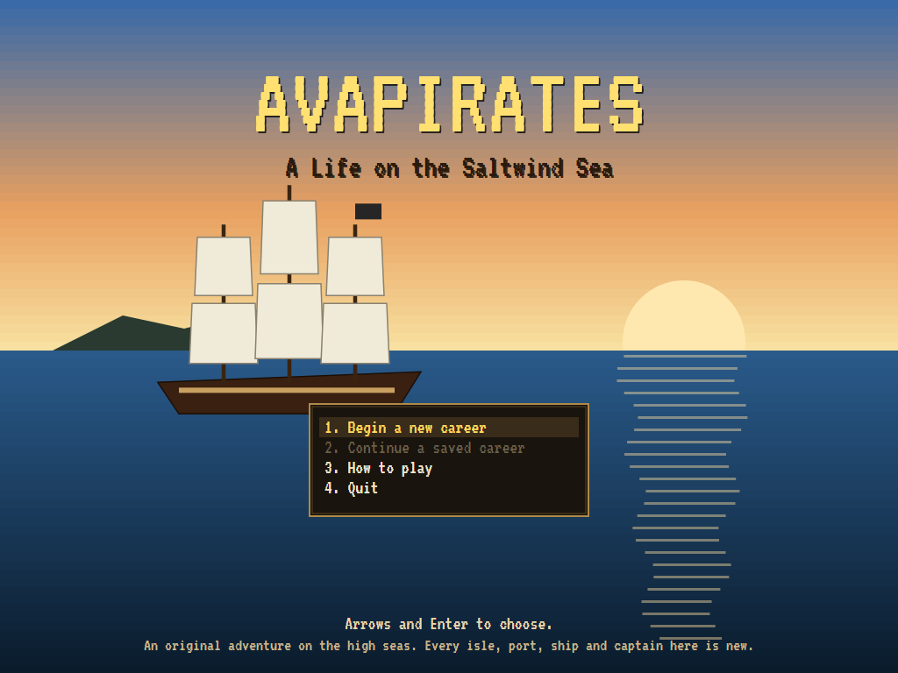 | 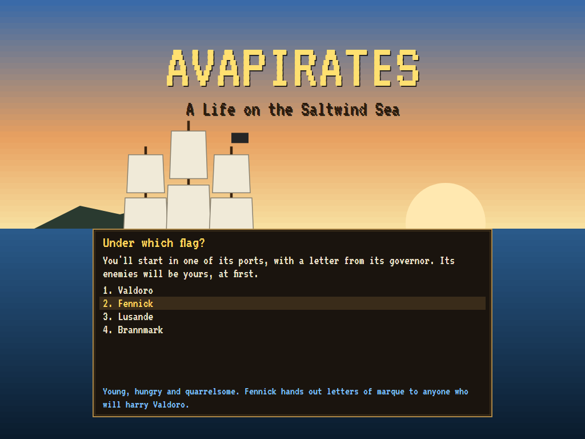 | 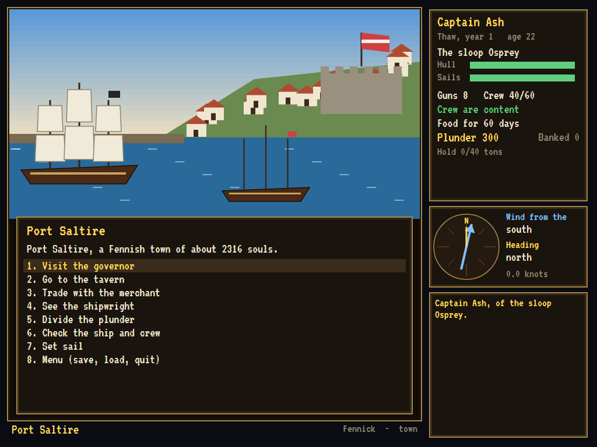 |
| A ship under full sail at sundown. | Four crowns to choose from. | Every port is a harbour, a fort and a town. |

| The tavern | The merchant | The governor |
|:----------:|:------------:|:------------:|
| 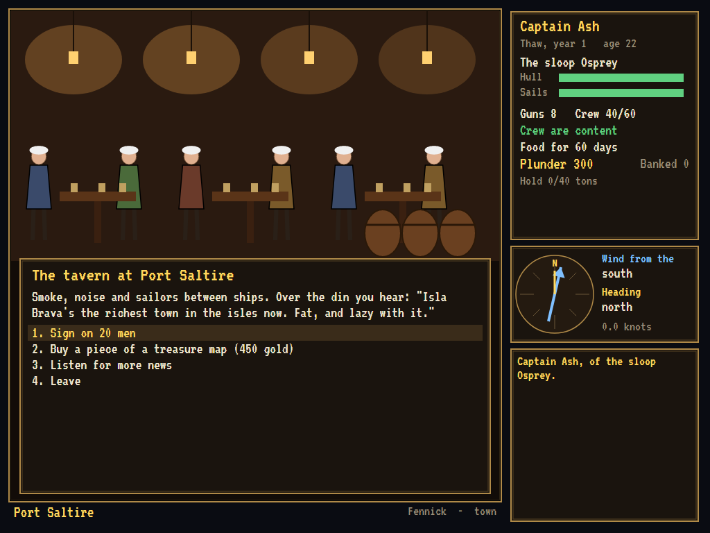 | 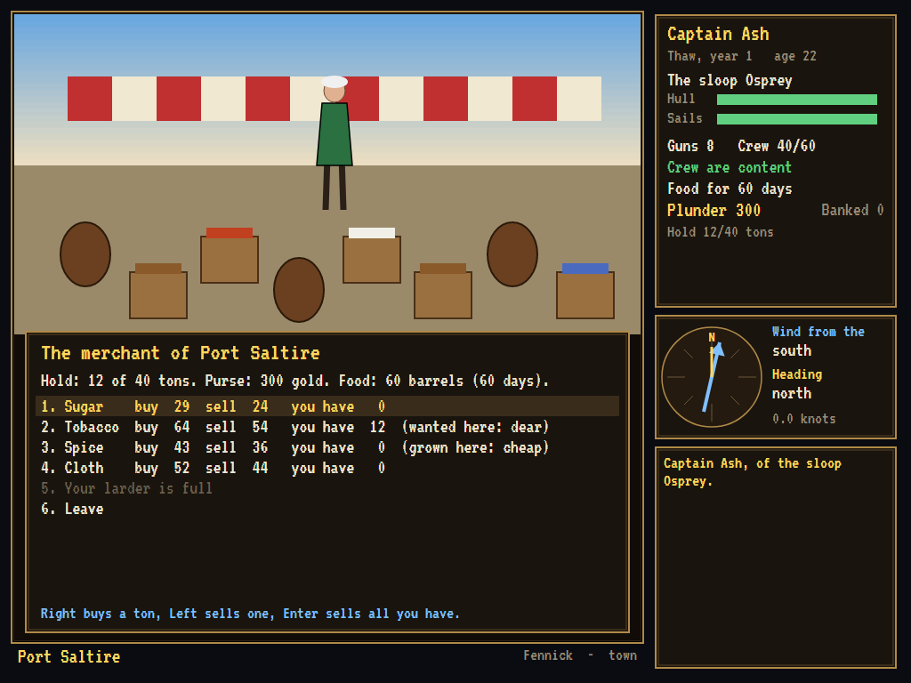 | 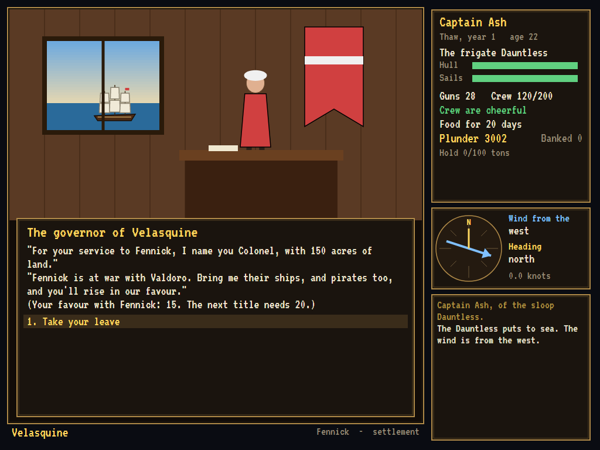 |
| Men to sign on, rumours, and a map to buy. | Cheap where it grows, dear where it's wanted. | Made a Colonel of Fennick, with land. |

| At sea | The chart | A sail! |
|:------:|:---------:|:-------:|
| 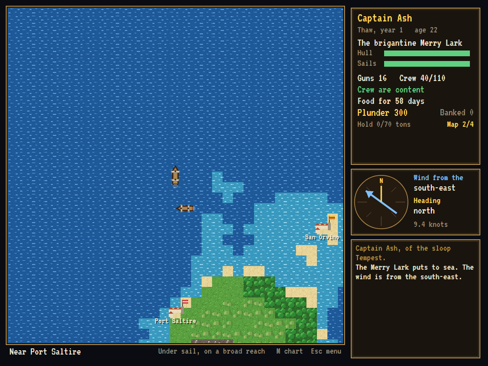 | 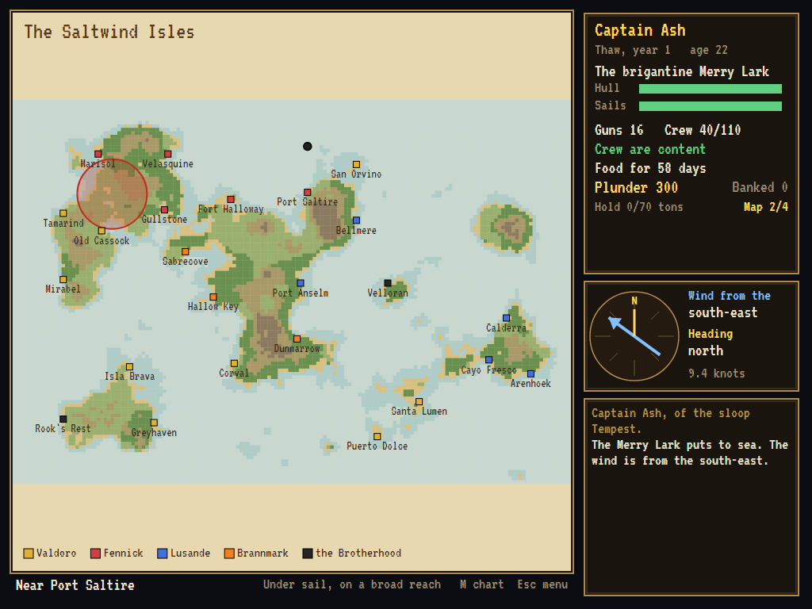 | 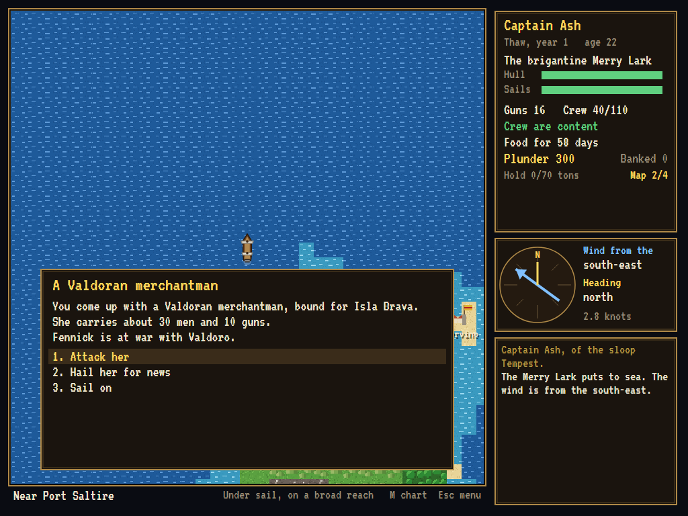 |
| On a broad reach, with ships in sight. | The isles, and where the treasure lies. | A Valdoran merchantman, and a choice. |

| A broadside | Boarders away | Storming a town |
|:-----------:|:-------------:|:---------------:|
| 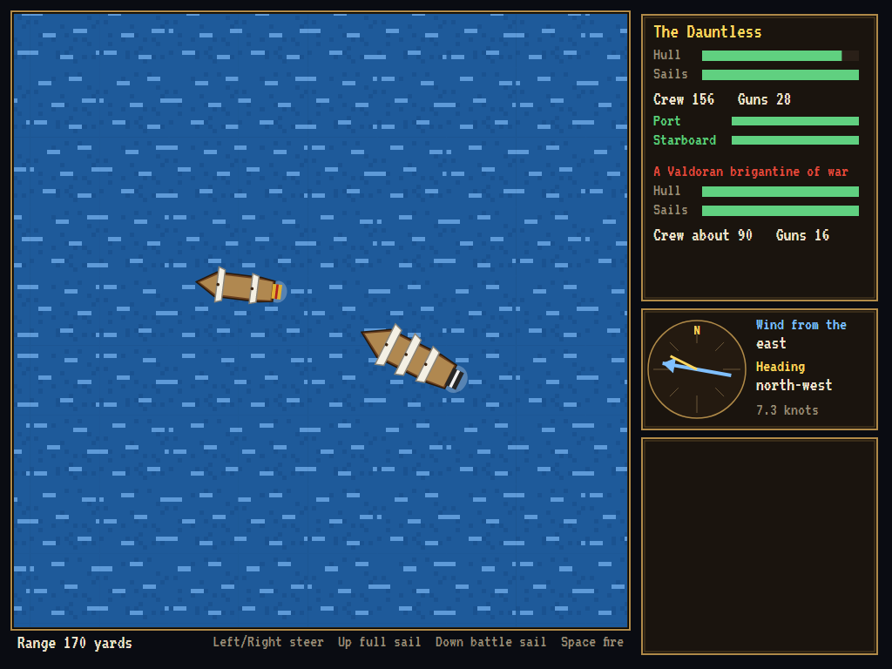 | 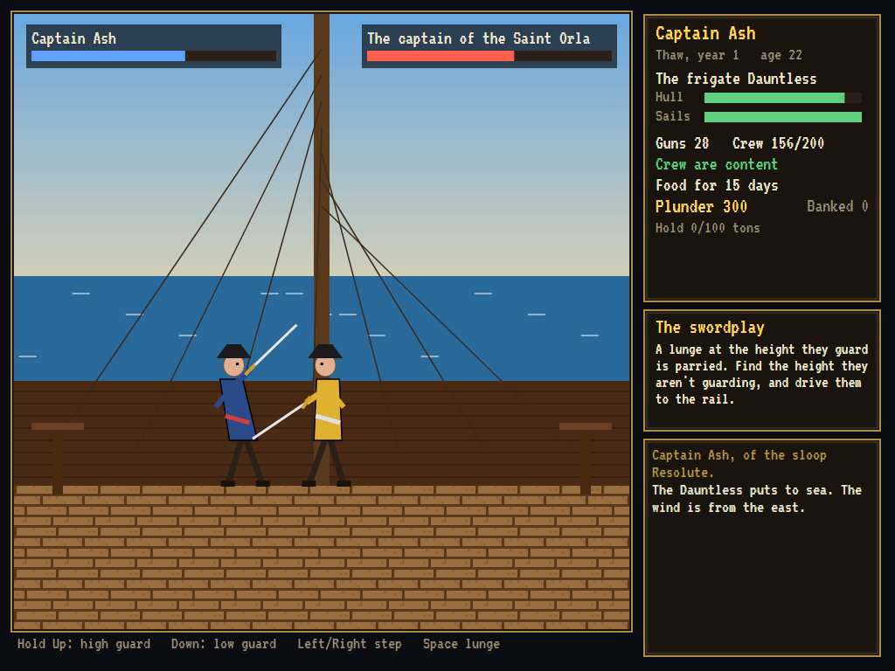 | 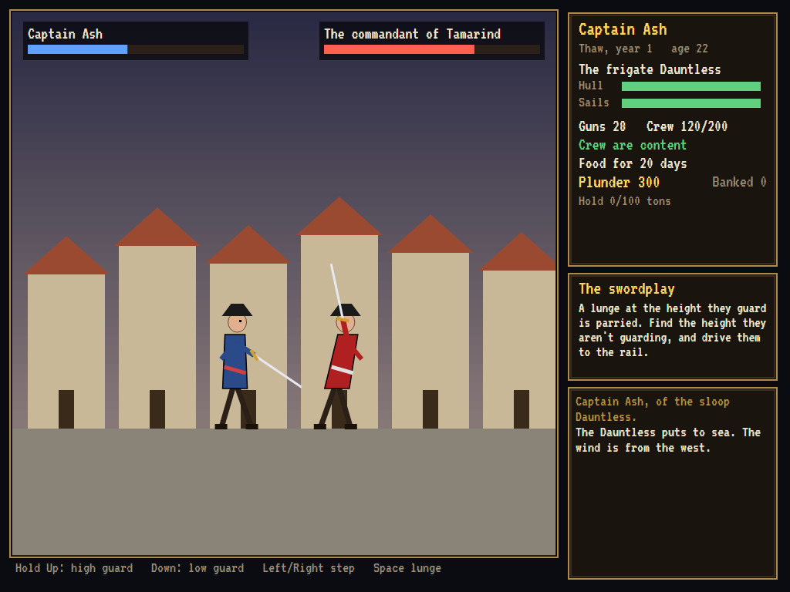 |
| A frigate against a Valdoran brigantine. | Captain against captain on her deck. | The commandant of Tamarind falls back. |

| Sacked | Retired | |
|:------:|:-------:|:-:|
| 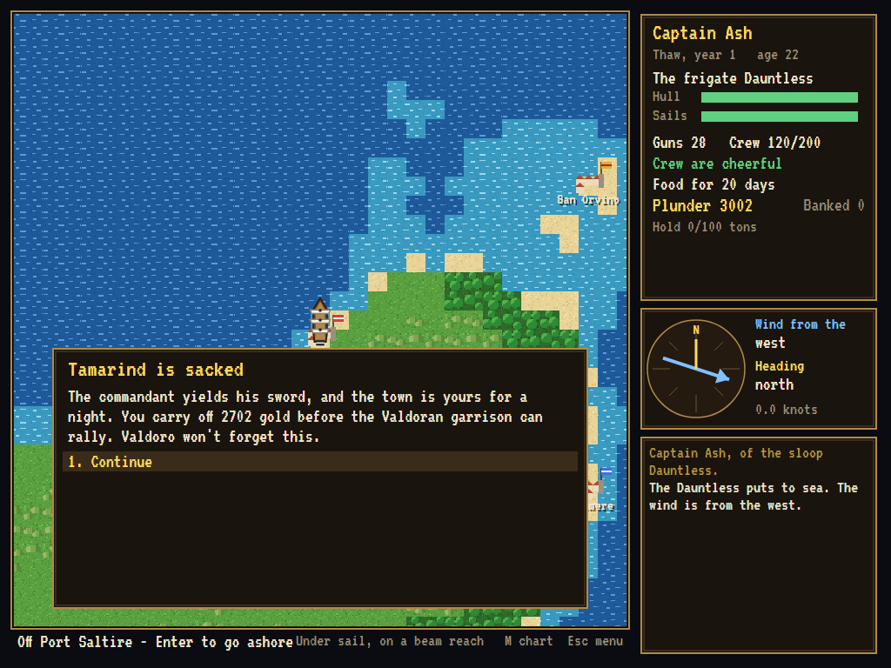 | 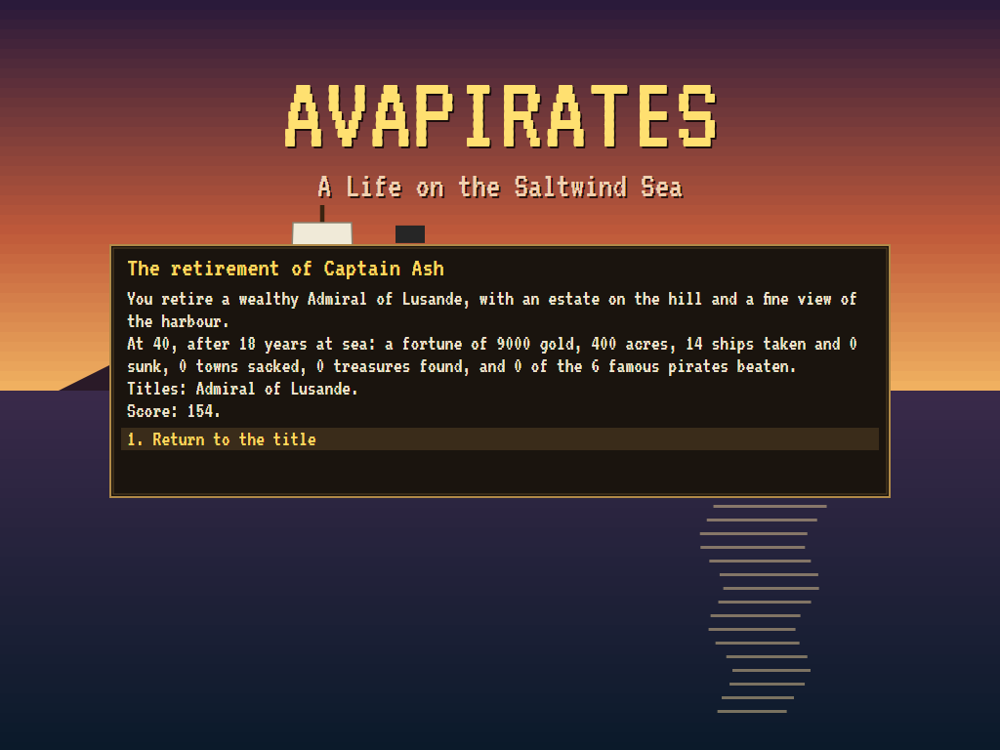 | |
| A night's plunder. | An Admiral of Lusande, with an estate on the hill. | |

The tests make these screenshots by playing the game in a real (headless) window; see
[Tests](#tests).

## Download and run

The [Releases page](https://github.com/Harlock123/AVAPirates/releases/tag/latest) has ready-to-run builds
for Windows, macOS and Linux, on both Intel/AMD and ARM. **Latest build** is rebuilt on every push to
`main`. Each download is one self-contained executable, so there's no .NET to install.

| Platform | Archive |
|---|---|
| Windows | `AVAPirates-win-x64.zip`, `AVAPirates-win-x86.zip`, `AVAPirates-win-arm64.zip` |
| macOS | `AVAPirates-osx-arm64.tar.gz` (Apple silicon), `AVAPirates-osx-x64.tar.gz` (Intel) |
| Linux | `AVAPirates-linux-x64.tar.gz`, `AVAPirates-linux-arm64.tar.gz`, `AVAPirates-linux-arm.tar.gz` |

```bash
tar -xzf AVAPirates-linux-x64.tar.gz     # or linux-arm64, linux-arm, osx-arm64, osx-x64
./AVAPirates
```

On Windows, unzip the archive and run `AVAPirates.exe`. On macOS, if Gatekeeper refuses to open it,
run `xattr -d com.apple.quarantine AVAPirates` once. To play without sound, run it with `--no-audio`.

**Sound** comes through OpenAL Soft, which is built in for every platform. In a virtual machine the
game detects the VM and uses a larger audio buffer, so the sound doesn't break up.

## Controls

| At sea | |
|---|---|
| **Left** / **Right** | Steer |
| **Up** / **Down** | Hoist sail / take it in |
| Sail into a port, or **Enter** beside one | Go ashore |
| Sail into a ship | Meet her |
| **M** | The chart |
| **D** | Dig for treasure on the nearest beach |
| **S** / **J** | The ship's books / the captain's log |
| **Esc** | The menu: save, load, help, quit |

| In a sea fight | |
|---|---|
| **Left** / **Right** | Steer |
| **Up** / **Down** | Full sail / battle sail (slower, but turns tighter) |
| **Space** | Fire the broadside facing her (each side reloads on its own) |

| With a sword | |
|---|---|
| Hold **Up** / hold **Down** / neither | Guard high / low / middle |
| **Left** / **Right** | Step back / step in |
| **Space** | Lunge at the height you're guarding |

In menus, the arrows and **Enter** choose (or press a number). At the merchant, **Right** buys a ton,
**Left** sells one, and **Enter** sells all you have. **F2** or **Ctrl+M** mutes the sound;
**Ctrl+S** saves a screenshot in a `Screenshots` folder beside the program.

## Tests

```bash
dotnet test AVAPirates.slnx
```

The engine has no UI and takes its keys by name: presses for orders, and keys held down for the helm
and the sword. Sailing and fighting run on a fixed sixty-steps-a-second clock, so the tests play
exactly as a person does. They check:

- **The isles**:
  - **The same every time:** the isles always come out the same.
  - **Ports:** every port can be sailed to from every other.
  - **Crowns:** Valdoro holds the most ports, and the Brotherhood two havens.
- **Sailing**:
  - **Points of sail:** fastest across the wind, barely into it.
  - **Helm and sails:** steering, setting and taking in sail.
  - **Time:** the days pass, food runs low, and the crew sour on an empty larder.
  - **Ports:** sailing into one friendly or hostile.
- **Ports**:
  - **The tavern:** signing on men.
  - **The merchant:** prices where goods grow and where they're wanted.
  - **The governor:** titles and land for favour won.
  - **Shares and repairs:** dividing the plunder, and the shipwright's bill.
- **Ships met at sea**:
  - **Meeting:** running into one.
  - **Who hunts you:** pirates, and warships of a crown you've angered.
  - **Consequences:** what each crown thinks of a prize, and a famous pirate's bounty.
- **Sea fights**:
  - **Gunnery:** cannonballs striking a ship-shaped target, broadsides firing from the side facing her and reloading, and slower loading with fewer hands.
  - **Outcomes:** merchants striking, a big crew boarding, and losing your only ship.
  - **Fair fights:** evenly matched ships fighting it out in reasonable time, with either able to win.
- **Sword fights**:
  - **The rules:** parries at the guarded height, hits anywhere else, and over the rail.
  - **What decides it:** crews putting heart in, and better swordsmen winning more.
  - **Boardings:** won and lost, and sacking a town.
- **The career**:
  - **Time:** the months bringing restlessness, wars and the treasure galleon, and mutiny.
  - **Treasure and retirement:** the four-piece treasure map, and retirement's score and fate.
  - **The machine:** saving and loading, and the attract demo.

The screenshot tests draw the real screen in a headless window. To refresh the README's pictures:

```bash
PIRATES_SHOTS=$PWD/Images dotnet test tests/AVAPirates.Tests --filter ScreenshotTests
```

To see how sea fights and sword fights tend to go, with the computer's own helm and blade standing in
for a fair human player (for tuning):

```bash
PIRATES_BALANCE=1 dotnet test tests/AVAPirates.Tests --filter BalanceProbe --logger "console;verbosity=detailed"
```

## Building

```bash
dotnet build AVAPirates.slnx
dotnet run --project src/AVAPirates
```

You'll need the .NET 10 SDK. `tools/make_sounds.py` makes the sounds and needs only standard-library
Python: `python3 tools/make_sounds.py` rewrites `src/AVAPirates/Sounds`.

## Project structure

```
AVAPirates/
├── AVAPirates.slnx
├── src/AVAPirates/
│   ├── Rules/                     # The crowns and their titles, ship types, trade goods, the RNG
│   ├── World/
│   │   ├── SeaMap.cs              # The Saltwind Isles, grown from a fixed seed, and routes across them
│   │   ├── WorldState.cs          # A career: fleet, crew, purse, hold, favour, wars, ports, maps
│   │   └── SaveStore.cs
│   ├── Sea/
│   │   ├── Sailing.cs             # Points of sail, headings and bearings
│   │   ├── Traffic.cs             # Merchants, warships, pirates, rivals, hunters, the galleon
│   │   ├── SeaBattle.cs           # The real-time sea fight
│   │   └── Duel.cs                # The sword fight
│   ├── Game/
│   │   ├── GameEngine.cs          # Panels, keys held and pressed, the fixed clock
│   │   ├── GameEngine.Title.cs    # The title, a new career, the demo
│   │   ├── GameEngine.Sea.cs      # Sailing, the calendar, meeting ships, treasure
│   │   ├── GameEngine.Port.cs     # Governor, tavern, merchant, shipwright, hostile ports
│   │   ├── GameEngine.Battle.cs   # Fights, prizes, boarding, storming towns
│   │   ├── GameEngine.Career.cs   # Dividing the plunder, retiring, the books, saving
│   │   ├── DemoPilot.cs
│   │   └── SoundManager.cs
│   ├── Audio/                     # The OpenAL engine (from the author's AVABand)
│   ├── Views/                     # The sea, the chart, battles, duels, ports, title
│   └── Sounds/                    # The synthesised effects and tunes
├── tests/AVAPirates.Tests/        # Gameplay, balance and screenshot tests
├── tools/make_sounds.py
└── Images/                        # Screenshots
```

## About and licence

AVAPirates © 2026 Lonnie Watson, under the [MIT License](LICENSE).

*Sid Meier's Pirates!* © 1987 MicroProse. The name belongs to its current owner. AVAPirates is an
independent, unofficial game in its style. Its isles, crowns, ports, ships, captains, graphics,
sounds, tunes and code are its own, and nothing is taken from that game. No rights holder is
affiliated with or endorses it.
